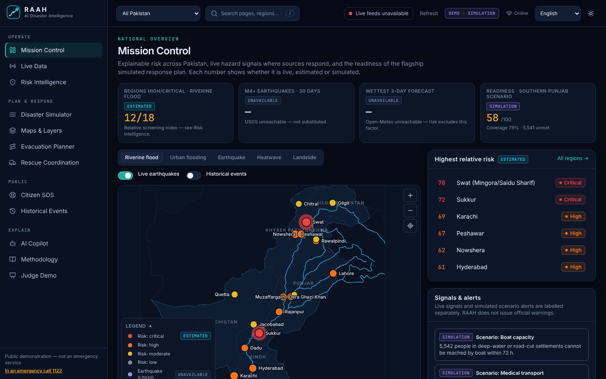
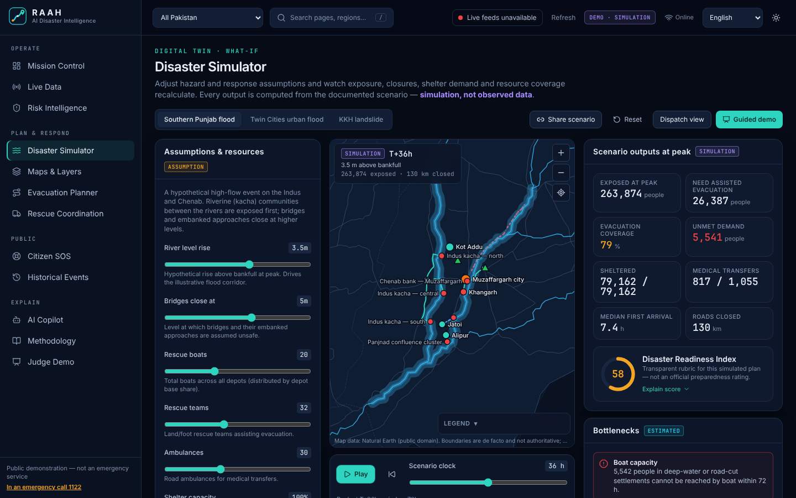
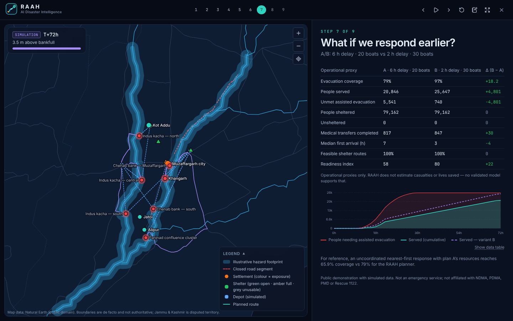
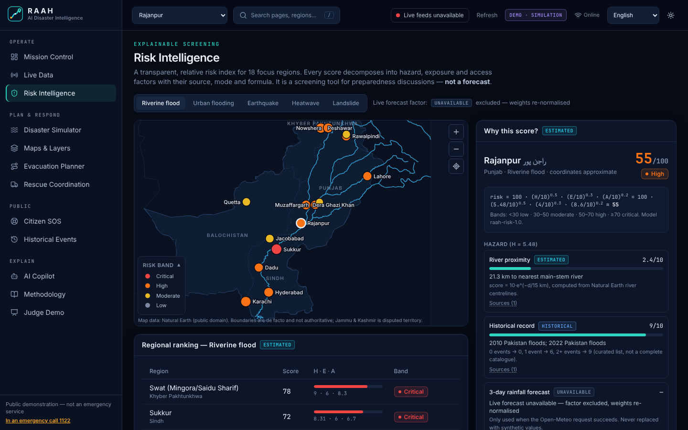
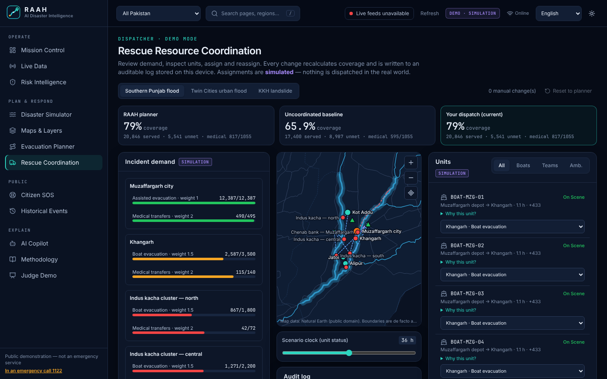

# RAAH — AI Disaster Intelligence for Pakistan

**Predict. Prepare. Protect.** *Raah* (راہ) means *the way*.

RAAH is an explainable disaster-intelligence and emergency-response planning platform for Pakistan. It screens risk across regions and hazards, simulates emergencies on real Pakistani geography, routes evacuations over a road network, allocates rescue resources, and explains every recommendation. Every number shown is labelled **live**, **historical**, **estimated**, **assumption** or **simulation**.

> **Public demonstration.** RAAH is not an emergency service, does not send alerts, and is not affiliated with NDMA, PDMA, PMD or Rescue 1122. Scenario outputs are simulations. In an emergency call **1122**.



## Live demo

- **Deployment:** not yet verified. See [Deploying to Vercel](docs/RELEASE_CHECKLIST.md#deploying-to-vercel-owner-steps). This README will link the real URL once it is deployed and checked.
- **Judge demo:** open `/demo`, press **→** to advance, **N** for presenter notes and **F** for fullscreen. It runs in about 4 minutes and works offline.

## What it does

| Capability | Route | What is real |
| --- | --- | --- |
| **Mission Control** — national overview with mode-badged KPIs, risk map, live signals and scenario alerts | `/mission-control` | Natural Earth map, USGS and Open-Meteo when reachable |
| **Risk Intelligence** — 5 hazards × 18 regions; each score decomposes into factors with formula, source and uncertainty | `/risk` | Computed from geometry, curated history and labelled analyst classes |
| **Disaster Simulator (digital twin)** — Southern Punjab riverine flood, Islamabad–Rawalpindi urban flood, KKH landslide; sliders, scenario clock, closures, shelters, strategy | `/simulator` | Real rivers and roads; simulated hazard and demand |
| **A/B comparison & Readiness Index** — early vs late response, boats ×2, crossing closed, shelter lost, uncoordinated baseline | `/simulator` | Deterministic re-runs; operational proxies only |
| **Evacuation Planner** — Dijkstra over a 4,251-node road graph with hazard closures and alternative routes | `/evacuation` | Natural Earth road graph |
| **Rescue Coordination** — needs, units, assign/reassign/stand down, unit status by clock, audit log, planner vs baseline vs your dispatch | `/resources` | Simulated |
| **Citizen SOS** — verified emergency numbers, preparedness, kit checklist, privacy-first SOS demo with case lifecycle, in English, اردو and Roman Urdu | `/sos` | Numbers verified; SOS is a demo that stays on the device |
| **AI Copilot** — grounded answers that separate facts, estimates, assumptions and advice; counterfactual "what if" re-runs; optional Qwen narrative | `/copilot` | Facts come from the engines; the LLM never invents numbers |
| **Maps & Layers / Historical Events / Live Data / Methodology** | `/map`, `/history`, `/live`, `/methodology` | Sourced and documented |

<p>




</p>

## Example result (default flood scenario, deterministic)

| | Plan A: 6 h delay, 20 boats | Plan B: 2 h delay, 30 boats | Uncoordinated baseline (A's resources) |
| --- | --- | --- | --- |
| Assisted-evacuation coverage | 79.0% | 97.2% | 65.9% |
| People sheltered (of 79,162) | 79,162 | 79,162 | 46,000 |
| Median first arrival | 7.4 h | 3.4 h | 7.0 h |
| Readiness index | 58 | 80 | 52 |

These are simulation outputs from documented assumptions. They are not observed data, and RAAH makes no casualty claims.

## Architecture

A single **Next.js 15** app (App Router, React 19, TypeScript strict, Tailwind CSS 4). Deterministic engines in `lib/` run in the browser and on the server.

```
lib/geo        d3-geo data · road graph · Dijkstra · alternatives
lib/risk       explainable risk index
lib/scenario   hazard footprints · exposure · closures · shelter + unit allocation · readiness · URL codec
lib/providers  USGS + Open-Meteo adapters (DataProvider<T>, timeouts, zod)
lib/copilot    deterministic explainer + optional Qwen (Alibaba Cloud Model Studio)
public/sw.js   offline service worker (precaches every route and chunk)
```
Details: [docs/ARCHITECTURE.md](docs/ARCHITECTURE.md) · Methods: [docs/MODEL_METHODOLOGY.md](docs/MODEL_METHODOLOGY.md) · Data: [docs/DATA_SOURCES.md](docs/DATA_SOURCES.md)

## Getting started

Requires Node.js ≥ 20.9.

```bash
npm ci
cp .env.example .env.local   # optional; the app needs no keys
npm run dev                  # http://localhost:3000
```

| Script | Purpose |
| --- | --- |
| `npm run build` / `npm start` | Production build and server |
| `npm run lint` · `npm run typecheck` · `npm test` | ESLint · TypeScript · Vitest (62 tests) |
| `npm run test:e2e` | Playwright (desktop and mobile); set `PW_CHROMIUM_PATH` to use a preinstalled Chromium |
| `npm run verify` | lint + typecheck + test + build |
| `npm run data:build` | Rebuild geodata from Natural Earth GeoJSON in `data-raw/` |

### Environment variables
All optional and read server-side only. See [.env.example](.env.example).

| Variable | Purpose |
| --- | --- |
| `DASHSCOPE_API_KEY` | Enables the Qwen narrative in the Copilot. Without it, the deterministic explainer answers. |
| `QWEN_MODEL`, `QWEN_BASE_URL`, `QWEN_TIMEOUT_MS` | Model, endpoint (international by default) and timeout |
| `NEXT_PUBLIC_SITE_URL` | Canonical URL for social previews |

## Validation

Lint clean · type check clean · **62/62** unit and integration tests · production build passes · **30/30** Playwright end-to-end tests (desktop and mobile, 4 desktop-only checks skipped on mobile) · offline mode verified · `npm audit --omit=dev`: 0 vulnerabilities. Measured Lighthouse scores and the full evidence are in [docs/RELEASE_CHECKLIST.md](docs/RELEASE_CHECKLIST.md).

## Honest status

- **Real:** Natural Earth geography and road graph; USGS and Open-Meteo when reachable; curated historical events; verified emergency numbers.
- **Simulated:** scenario hazards, populations, shelters, assets, demand, dispatch, SOS lifecycle.
- **Not validated:** the risk index against losses; footprints against real inundation; unit rates against operations. No ML model is trained.
- **Not built:** authentication and roles, official data feeds, real alerting, street-level routing.

See [docs/LIMITATIONS.md](docs/LIMITATIONS.md) and [docs/EXISTING_APP_AUDIT.md](docs/EXISTING_APP_AUDIT.md).

## Presentation materials

[Demo script, speaker script and recovery plan](docs/DEMO_SCRIPT.md) · [Slide outline and judges' Q&A](docs/PRESENTATION.md)

## Credits and licence

Map data © [Natural Earth](https://www.naturalearthdata.com/) (public domain). Earthquakes: [USGS](https://earthquake.usgs.gov/) (public domain). Forecasts: [Open-Meteo](https://open-meteo.com/) (CC BY 4.0).

© Shan Iqbal · ZZ Tech Labs. **No open-source licence has been chosen yet**, so all rights are reserved until the owner selects one.
